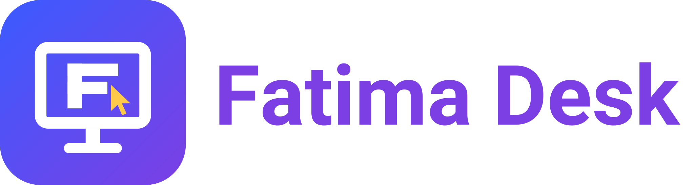

<p align="center">
  <br>
  <b>Fatima Desk</b> — remote desktop for Windows, macOS, Linux and Android<br>
  <a href="#download">Download</a> •
  <a href="#features">Features</a> •
  <a href="#install">Install</a> •
  <a href="#server">Server</a> •
  <a href="#building">Building</a> •
  <a href="#license">License</a>
</p>

Fatima Desk lets you see and control another computer or phone, copy files and
the clipboard between them, and chat, over the internet or your local network.
It talks only to its own server, so connections, device IDs and the relay stay
under your control.

Fatima Desk is built on [RustDesk](https://github.com/rustdesk/rustdesk)
(AGPL-3.0) and keeps its core: the remote-control engine, video codecs, file
transfer and relay protocol. On top of that it adds its own branding, its own
server, numeric IDs with aliases, an admin Console and its own installers.

> [!Caution]
> Use Fatima Desk only on devices you own or are allowed to access. Using it
> for unauthorized access, control or invasion of privacy is not permitted.

## Download

All files are on the [latest release](https://github.com/hassanxs/fatima-desk/releases/latest)
([v1.5.3-fd1](https://github.com/hassanxs/fatima-desk/releases/tag/v1.5.3-fd1)).

| Platform | File |
|---|---|
| Windows 10/11 (x64) | `fatimadesk-1.5.3-x64.msi` (recommended), `fatimadesk-1.5.3-install.exe`, or the portable `.zip` |
| macOS, Apple Silicon | `fatimadesk-1.5.3-aarch64.dmg` |
| macOS, Intel | `fatimadesk-1.5.3-x86_64.dmg` |
| Linux x86_64 | `.deb` (Debian, Ubuntu, Mint), `.rpm` (Fedora), `-suse.rpm` (openSUSE) |
| Android 5.1 or newer | `fatimadesk-1.5.3-arm64-v8a.apk` (most phones), `armeabi-v7a.apk` (old 32-bit phones) |

## Features

- **Remote control** of the screen, keyboard and mouse, with multiple monitors,
  quality settings and a direct or relayed connection.
- **File transfer**, and **copy-paste of files and text** between the two sides.
- **Device IDs you control:** every device gets a 9-digit ID. Only the server
  admin can change it (from the Console); devices apply the change themselves.
- **Aliases:** a device can also have a name such as `Office-PC@fd`. Typing the
  alias, with or without `@fd`, connects just like the ID. A device sets its
  alias once; after that only the admin can change it.
- **Admin Console** (in the server repo): devices online, connections, relay
  usage and limits, IP blocking, aliases and ID assignment.
- **Android:** share the phone's screen, let a PC control it, or control your
  PCs from the phone.

## Install

Step-by-step instructions for installing, connecting, aliases, Android and
troubleshooting are in the [user guide](docs/USER-GUIDE.md).

- **Windows:** run the MSI. Windows SmartScreen or some antivirus programs may
  warn because the app isn't code-signed yet; choose *More info → Run anyway*.
- **macOS:** open the DMG and drag Fatima Desk to Applications. The app isn't
  notarized, so the first time right-click it and choose *Open*. Then allow
  *Screen Recording* and *Accessibility* in System Settings → Privacy &
  Security. Intel Macs need a Metal-capable graphics driver.
- **Linux:** install the package (`sudo apt install ./fatimadesk-1.5.3-x86_64.deb`).
  It runs a background service so the computer can be reached after a reboot.
  Remote control needs an X11 session; the Wayland login screen isn't supported.
- **Android:** allow *Install unknown apps* for your browser or file manager,
  install the APK, then in the app tap *Start service* under *Share screen*. To
  let a PC control the phone, turn on *Input control* and enable
  *Fatima Desk Input* in Accessibility.

## Server

Fatima Desk needs a Fatima Desk server: the ID server (`hbbs`), the relay
(`hbbr`) and the optional admin Console. Their source, Docker setup and
deployment notes are in
[hassanxs/fatima-desk-server](https://github.com/hassanxs/fatima-desk-server).

The released apps are built for the project's own server. To use the app with
a server of your own, set your server's address and public key in
`RENDEZVOUS_SERVERS` and `RS_PUB_KEY` in
[`libs/hbb_common/src/config.rs`](https://github.com/hassanxs/fatima-desk-hbb_common/blob/fatima-desk/src/config.rs)
and build the app yourself.

## Building

The code is Rust (core) plus Flutter (user interface), bridged with
`flutter_rust_bridge` 1.80.1. `libs/hbb_common` is a git submodule
([hassanxs/fatima-desk-hbb_common](https://github.com/hassanxs/fatima-desk-hbb_common)),
so clone with submodules:

```sh
git clone --recurse-submodules -b fatima-desk https://github.com/hassanxs/fatima-desk.git
```

- **Windows:** `build-windows.ps1` builds the app; `build-windows.ps1 -Installer`
  also makes the installer `.exe`, portable `.zip` and `.msi`. It needs Visual
  Studio 2022 Build Tools (C++), Rust 1.75, LLVM 15, Flutter 3.24.5, vcpkg and
  Python; the header of the script lists the exact setup.
- **macOS and Linux:** run the *Fatima Desk build* workflow
  (`.github/workflows/fatima-desk-build.yml`) from the Actions tab and choose the
  targets. The packages appear as workflow artifacts.
- **Android:** run the *Fatima Desk Android* workflow
  (`.github/workflows/fatima-desk-android.yml`). Signing uses the repository
  secrets `ANDROID_SIGNING_KEY`, `ANDROID_ALIAS`, `ANDROID_KEY_STORE_PASSWORD`
  and `ANDROID_KEY_PASSWORD`; a fork needs its own key.

Building follows RustDesk's process, so RustDesk's
[build documentation](https://rustdesk.com/docs/en/dev/build/) also applies.

### Code layout

| Path | What it is |
|---|---|
| `src/` | Rust core: connections, screen/audio/input services, platform code |
| `src/fatimadesk_alias.rs` | Fatima Desk aliases and server-assigned IDs |
| `flutter/` | User interface for desktop and mobile |
| `libs/hbb_common/` | Shared protocol, config and networking (submodule) |
| `libs/scrap`, `libs/enigo`, `libs/clipboard` | Screen capture, input, clipboard |
| `res/`, `branding/` | Icons, installer resources, logo generator |

## Contributing and security

Issues and pull requests are welcome; see [CONTRIBUTING](docs/CONTRIBUTING.md).
Please report security problems privately as described in
[SECURITY](docs/SECURITY.md), not in a public issue.

## License

Fatima Desk is free software under the
[GNU Affero General Public License v3.0](LICENCE).
Copyright © 2026 Hassan Latif. Based on
[RustDesk](https://github.com/rustdesk/rustdesk), copyright © the RustDesk
developers, also AGPL-3.0, and other open-source components under their own
licenses.

Made with heart in Pakistan!
